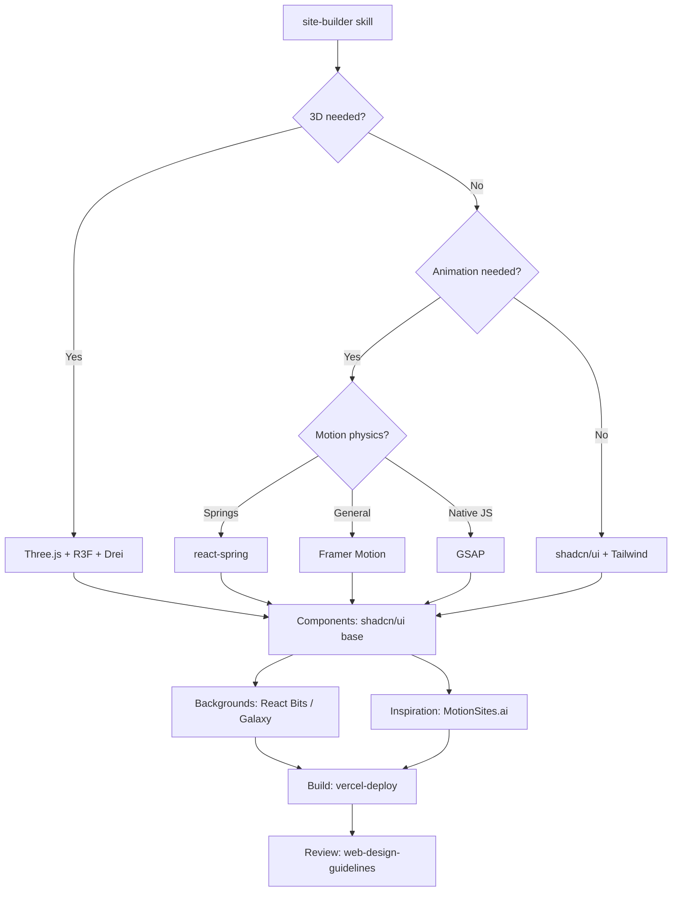

# Web Dev Libraries & Tools — MOC

Biblioteca de elementos e referências para desenvolvimento de páginas e apps web. Organizado por categoria.

## Animação (JavaScript / React)

Bibliotecas de animação para web, motion graphics e micro-interações.

| Library | Stars | Stack | Primary Use | Página |
|---------|-------|-------|-------------|--------|
| **GSAP** | 28.5k | JS (vanilla) | Animação JavaScript nativa, scroll-driven, SVG, timeline | [[38.01-gsap]] |
| **Motion** (Framer Motion) | 33.7k | React | Animação declarativa React, spring physics, layout transitions | [[38.02-motion]] |
| **react-spring** | 29.2k | React | Animação baseada em física de molas (springs) | [[38.17-react-spring]] |

## 3D / WebGL

| Library | Stars | Stack | Primary Use | Página |
|---------|-------|-------|-------------|--------|
| **Three.js** | 115.7k | JS (WebGL/WebGPU) | 3D web — cenas, geometria, materiais, webgpu, XR | [[38.03-threejs]] |
| **react-three-fiber** | 32.4k | React + Three.js | React renderer declarativo para Three.js | [[38.15-r3f]] |
| **Drei** | 9.9k | React + R3F | Helpers, hooks e componentes para R3F | [[38.12-drei]] |

## React Component Libraries

Collections de componentes React, desde micro-interações até sistemas completos.

| Library | Stars | Stack | Primary Use | Página |
|---------|-------|-------|-------------|--------|
| **React Bits** | 47.6k | React + Tailwind | 200+ componentes animados prontos (text, bg, UI, micro) | [[38.04-react-bits]] |
| **Magic UI** | 22.3k | React + Tailwind + Motion | Componentes copy-paste para landing pages | [[38.11-magicui]] |
| **Animate UI** | 4.3k | React + Tailwind + Motion | Componentes animados via shadcn CLI | [[38.14-animate-ui]] |
| **Berlix** | 48 | React + Tailwind + Motion | Componentes copy-paste Motion, sem config | [[38.13-berlix]] |
| **Galaxy** (UIverse) | 13k | CSS / Tailwind | 3000+ elementos UI feitos pela comunidade | [[38.05-galaxy]] |
| **21st** | 5.5k | React + Tailwind + shadcn | Marketplace de componentes shadcn-based | [[38.06-21st]] |
| **Unlumen UI** | 63 | React + Tailwind + shadcn | Registry público de componentes shadcn | [[38.07-unlumen]] |

**Foundation (Componentes de base)**

Bibliotecas base para construir qualquer site — não são temas, são blocos de construção.

| Library | Stars | Stack | Primary Use | Página |
|---------|-------|-------|-------------|--------|
| **shadcn/ui** | 124.2k | React + Tailwind + Radix | Component library copy-paste (botões, dialogs, forms, tables) | [[38.16-shadcn]] |
| **Radix UI** | 30.2k | React (headless) | Primitivas acessíveis sem estilo (base do shadcn) | [[38.19-radix-ui]] |

## Agent / AI Dev Tools

Plataformas e skills para desenvolvimento com agentes de IA.

| Library | Stars | Stack | Primary Use | Página |
|---------|-------|-------|-------------|--------|
| **Watermelon Platform** | 535 | Bun + Next.js + MCP | 850+ exemplos de código via MCP (busca, inspiração, composição) | [[38.08-watermelon]] |
| **Refero Skill** | 270 | Python | Skill de design research-first para agentes (150k+ telas reais) | [[38.09-refero]] |

## Galleries / Inspiration Sites

| Site | Description | Página |
|------|-------------|--------|
| **MotionSites.ai** | Galeria de sites AI-designed com prompts exportáveis, filtráveis por categoria (creative, tech, luxury, etc.) | [[38.10-motionsites]] |

## Master Skill (para agentes)

| Skill | Público | Descrição |
|-------|---------|-----------|
| **site-builder** | Agentes de frontend | Orquestra todas as skills e tools do vault. Usar sempre no início de um projeto web. | [[38.18-site-builder-skill]] |

## Quick Decision Matrix

| Use Case | Recommended Tool |
|----------|-----------------|
| Animação JS nativa (sem React) | **GSAP** |
| Animação React (declarativa, springs) | **Motion** |
| Animação React (física/molas) | **react-spring** |
| 3D web interativo (vanilla JS) | **Three.js** |
| 3D web (React declarativo) | **react-three-fiber + Drei** |
|| Component library base padrão | **shadcn/ui** |
|| Primitivas acessíveis (headless) | **Radix UI** |
|| Starters & templates | **[[38.20-starters]]** |
| Micro-interações / background animado | **React Bits** |
| Landing page components rápidos | **Magic UI** |
| Componentes shadcn-based | **21st** ou **Unlumen** |
| Snippets CSS/Tailwind prontos | **Galaxy** (UIverse) |
| Inspiração AI sites/interactive | **MotionSites.ai** |
| Exemplos de código via MCP | **Watermelon Platform** |
| Design research antes de build | **Refero Skill** |

## Projetos Ativos

Projetos de landing page e apps em desenvolvimento.

| Projeto | Status | Deploy | Página |
|---------|--------|--------|--------|
| **Taroth App** | live | https://taroth-app-one.vercel.app | [[38.21-taroth-landing]] |
| **Taroth UI/UX Redesign** | live (fase 1-5 ✅) | https://taroth-app-one.vercel.app | [[38.23-taroth-openspec]] |
| **Taroth Tree-of-Life** | redesign | https://taroth-app-one.vercel.app | [[38.22-tree-of-life-redesign]] |

## Conexões

- [[38.18-site-builder-skill]] — Orquestrador master para agentes
- [[31.07-[ferramenta]-setup]] — Geração de assets
- [[27.01-after-effects-mcp]] — MCP para After Effects
- [[37.00-_index]] — Regras e decisões

## 📊 TAXONOMIA DE SKILLS EXISTENTES NO VAULT

Skills de frontend já instaladas (em `~/.agents/skills/`):

| Skill | Pasta | Domínio |
|-------|-------|---------|
| `frontend-skills` | frontend-skills/ | React 19, Next.js, Tailwind, component design, testing |
| `frontend-design` | design__taste-skill/ | Visual design, anti-slop, typography, component design |
| `vercel-react-best-practices` | design__soft-skill/ | 70 performance rules para React/Next.js |
| `vercel-deploy` | vercel-deploy/ | Deploy Next.js on Vercel with public access |
| `webapp-testing` | webapp-testing/ | Toolkit para testing de web apps locais |
| `image-to-code` | design__image-to-code-skill/ | Elite frontend image-to-code skill for Codex |
| `design` | design/ | Design GATE para all visual work — sites, UI, app screens |
| `design-decisions` | design-decisions/ | CRAP/Lupton/Heller/Dondis rules |
| `minimalist-ui` | minimalist-skill/ | Clean editorial-style interfaces, warm monochrome |
| `gpt-taste` | gpt-tasteskill/ | Elite UX/UI & Advanced GSAP Motion Engineer |
| `popular-web-designs` | design__stitch-skill/ | 54 real design systems as HTML/CSS |
| `imagegen-frontend-web` | design__imagegen-frontend-web/ | 1 img per landing section, design direction |
| `web-design-guidelines` | web-design-guidelines/ | Web Interface Guidelines compliance review |

## 🔄 FLUXO DE TRABALHO PARA AGENTES

